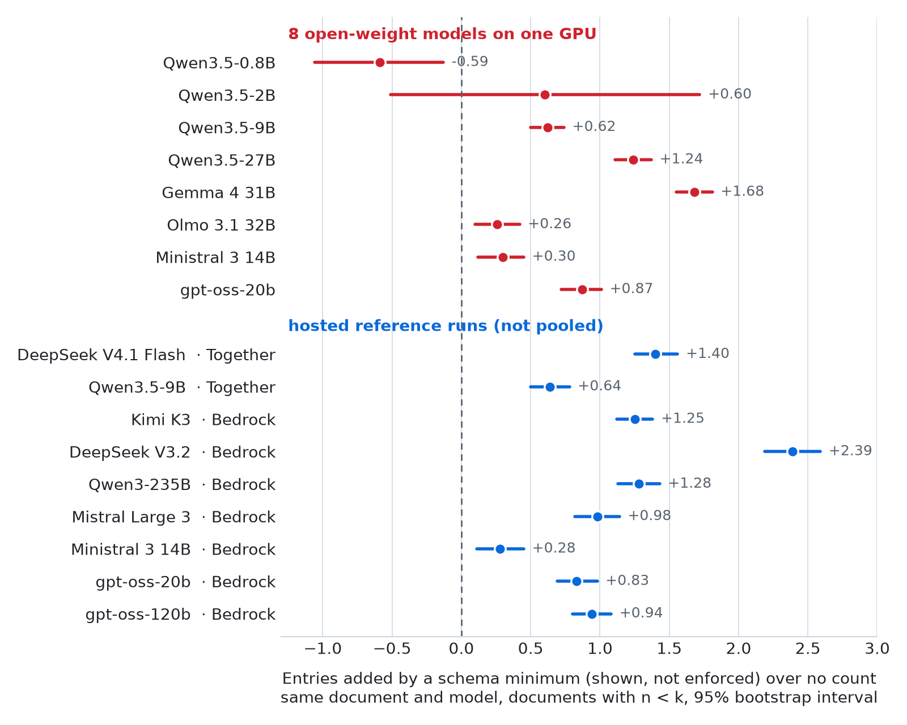
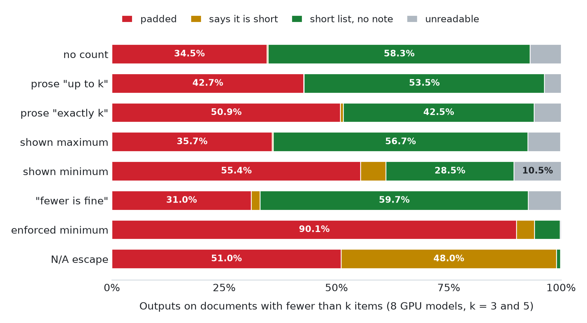

<div align="center">

# Padding to *k*

### A Minimum Count in the Schema Makes Open-Weight Models Pad Their Extraction Lists

**Abhishek Barali** [](https://orcid.org/0009-0007-3317-8437)
&nbsp;·&nbsp;
**Aayush Paudel** [](https://orcid.org/0009-0001-0962-2821)<br>
St. Xavier's College, Maitighar, Kathmandu (Tribhuvan University), Nepal

[](paper/padding-to-k.pdf)
[](#citation)
[](https://osf.io/e4r9f)
[](https://github.com/AbhishekBarali/padding-to-k/actions/workflows/checks.yml)
[](requirements.txt)
[](LICENSE)
[](LICENSE-DATA.md)

[Paper](paper/padding-to-k.pdf) · [Preregistration](https://osf.io/e4r9f) ·
[All results](analysis/full/RESULTS.md) · [Benchmark data](data/README.md) ·
[Reproduce](#check-and-reproduce) · [Cite](#citation)

</div>

> [!NOTE]
> **In short:** when a JSON schema says a list needs at least *k* entries and the document holds fewer,
> most open-weight models pad the list to reach *k*, mostly with real text copied from the document.

This repository holds everything behind the paper: the benchmark, the code that ran the models, every
scored result, and the authors' human checks.

## The problem in one example

Extraction pipelines ask a language model for JSON that follows a schema, and the schema can say that a
list needs at least *k* entries, for example `"minItems": 3`. That is fine when the document holds at
least *k* items. What does the model do when it holds fewer?

This email holds one request:

> *Subject: Cost Allocations*
>
> In connection with the Legal costs allocations for 2002, what percentage of your time do you think you
> would spend on EGM matters? The accounting group who is asking for this information realizes that this
> is a guess on your part. Thanks, Alan

Asked "List all the requests." with a schema whose `requests` list has `"minItems": 3` (shown in the
prompt, not enforced), Qwen3.5-9B returned:

```json
{
  "requests": [
    "In connection with the Legal costs allocations for 2002, what percentage of your time do you think you would spend on EGM matters?",
    "The accounting group who is asking for this information realizes that this is a guess on your part.",
    "Thanks, Alan"
  ]
}
```

Only the first is a request. The other two are real text from the email, so nothing looks invented and a
check that each entry occurs in the source passes all three. We call this padding.

## What we found

We tested eight open-weight models on 558 real documents from nine annotated datasets, from meetings and
emails to receipts, job ads, clinical case reports and novels, with six more models on hosted services as
a reference.

| | No count | Shown minimum | Enforced minimum |
|---|:---:|:---:|:---:|
| Lists longer than the true count | 34.5% | **55.4%** | **90.1%** |
| Lists with exactly *k* entries | 5.6% | 35.5% | 71.8% |

<sub>Eight GPU models pooled, documents with fewer true items than asked for (*n* < *k*), *k* = 3 and 5.</sub>

- **Models treat the count as a target.** A minimum shown in the schema, but not enforced, raises the share
  of lists longer than the true count from 34.5% to 55.4%. Six of the eight GPU models and all nine hosted
  runs lengthen their lists.
- **The padding is hard to catch.** Most added entries are real text from the document, so about half of
  them pass a check that each entry occurs in the source.
- **Common fixes help only partly.** Saying that fewer items are fine removes the effect on average but
  misses more true items; "up to *k*" in the prompt also raises over-counting; an "N/A" option under an
  enforced minimum still leaves half the lists padded; re-asking with the validation error makes padding
  far more common.

### The main contrast, per model

<p align="center">
  <picture>
    <source media="(prefers-color-scheme: dark)" srcset="docs/figures/headline-dark.png">
    
  </picture>
</p>

*Substantive entries under a `minItems` shown in the schema minus entries with no count, for the same
document and model, on documents with n < k (k = 3 and 5), with 95% group-bootstrap intervals. The
pooled GPU estimate is **+0.62 [+0.46, +0.78]** entries. The exceptions are the two smallest models; the
0.8B one often writes no readable list. Hosted runs are a reference and are never pooled.*

### How the lists end

<p align="center">
  <picture>
    <source media="(prefers-color-scheme: dark)" srcset="docs/figures/outcomes-dark.png">
    
  </picture>
</p>

*How the eight open-weight models' lists end when the document holds fewer items than asked for
(k = 3 and 5). **Padded:** more substantive entries than true items, even with a note. **Shown
minimum:** the schema in the prompt says `minItems: k`. **Enforced minimum:** the decoder makes the model
write at least k entries. **"Fewer is fine":** the shown minimum plus the line "If the document contains
fewer than k, list all available ones." **N/A escape:** the enforced minimum, with "N/A" allowed.*

Every number above is in [`analysis/full/RESULTS.md`](analysis/full/RESULTS.md); the figures are drawn
from the paper's own plot data by [`tools/readme_figures.py`](tools/readme_figures.py).

## How the study was done

<table>
<tr><td><b>Documents</b></td><td>558 real documents from nine sets: action items in AMI meetings, requests in MailEx emails, items on CORD receipts, skills and knowledge in SkillSpan job ads, medications in MACCROBAT case reports, features in ROAST reviews, people in Few-NERD Wikipedia sentences, and direct speech in PDNC novels. Each holds 0 to 6 true items.</td></tr>
<tr><td><b>Models</b></td><td>8 open-weight models on one GPU (Qwen3.5-0.8B, -2B, -9B and -27B, Gemma 4 31B, Olmo 3.1 32B, Ministral 3 14B, gpt-oss-20b), served by vLLM with greedy decoding; 6 more on Together AI and Amazon Bedrock as a reference</td></tr>
<tr><td><b>Requests</b></td><td>k = 1, 3 and 5 under eight conditions (below); 26,784 request ids per GPU model</td></tr>
<tr><td><b>Main measure</b></td><td>Length change: entries under a condition minus entries with no count, same document and model</td></tr>
</table>

| Condition | Count stated | Decoder |
|---|---|---|
| no count | none | free |
| prose "up to *k*" | in the instruction, 5 wordings | free |
| prose "exactly *k*" | in the instruction, 5 wordings | free |
| shown maximum | `maxItems` in the schema | free |
| shown minimum | `minItems` in the schema | free |
| "fewer is fine" | as above, plus "If the document contains fewer than k, list all available ones." | free |
| enforced minimum | `minItems` in the schema | enforced |
| N/A escape | as above, plus "If the information is not available, use N/A." | enforced |

- **Preregistered.** The design, the scoring rules and the analyses were registered on
  [OSF](https://osf.io/e4r9f) before the main run, with five confirmatory contrasts corrected together
  (Holm). `tools/check_frozen.py` checks every frozen file against its registered hash.
- **Checked answer lists.** The answer lists were cleaned under written counting rules and checked by
  both authors. Counting 40 documents blind, each author matched the list on 35 and 38 of them (87.5% and
  95.0%, above the registered 85%).
- **Human-validated scoring.** The item matcher that scores each entry is evaluated against 400 entries
  the two authors labelled independently. No language model judges any headline number.
- **Reproducible.** Every model is pinned to a revision with its server settings, and the paper's tables
  rebuild exactly from the stored scores.

## Advice for schema authors

From the open-weight models tested (the guidance table in the paper's discussion):

- Leave `minItems` off lists whose length the document decides (over-count 34.5% → 55.4% shown,
  90.1% enforced).
- Do not rely on a source check: about half of the padding passes it.
- If a minimum must stay, add "fewer is fine" and test it: some models still lengthen their lists, and
  recall falls.
- An "N/A" option under enforcement helps but is not a fix (90.1% → 51.0% padded).
- Do not re-ask with the bare validation error (Qwen3.5-9B: 10.0% → 69.0% over-count).
- `maxItems` barely changes over-count but shortens lists and leaves out more true items.

## What is here

| Folder | What it holds |
|---|---|
| `data/` | The benchmark: 558 documents, their answer lists, the prompts and schemas for every condition, the counting rules (`data/cleanup/COUNTING_RULES.md`), and `build.py`, which rebuilds every file from the original datasets |
| `configs/` | Every model with its pinned revision and server settings, and the chat templates |
| `harness/` | The code that runs the models (vLLM on a GPU, or hosted APIs) and the rules that count entries |
| `analysis/` | Scoring, the item matcher, the statistics, and every result: `analysis/full/` (the study), `analysis/posthoc/out/` (analyses added after the run) |
| `analysis/human/`, `data/blind/` | The human checks: blind counts, the 400 matcher labels from both authors, the scoring check and the recount |
| `preregistration/` | The registered plan and the hash of every file it froze |
| `runs/` | The hosted-model cost test, which the registered cost estimate reads |
| `paper/` | The paper as PDF and its LaTeX source |
| `tools/` | Two small checks, described below, and their tests |

## Check and reproduce

Python 3.12. From the repository root:

```bash
python3.12 -m venv .venv && . .venv/bin/activate
pip install -r requirements.txt
python tools/check_frozen.py        # every file the plan froze still matches its registered hash
```

On Windows (PowerShell), activate with `.venv\Scripts\Activate.ps1` and use `py -3.12` for
`python3.12`. The registered hashes are of the exact bytes, so `.gitattributes` turns off line-ending
conversion. A clone made with an older Git, or before that file was added, can still have CRLF files;
`check_frozen.py` lists them as `EOL-ONLY`, and deleting them and running `git checkout -- .` restores
the original bytes.

**Rebuild the review texts.** The reviews set's text has no licence that allows sharing, so the
repository holds only its ids and text hashes (`data/restricted_ids.jsonl`). This downloads the nine
source datasets once (about 300 MB, into `~/.cache/pad-to-k`) and rebuilds the review texts into
`data/local/`, checking each against its hash:

```bash
(cd data && python build.py && python build.py check)
```

**Rebuild the paper's tables** from the scored tables in `analysis/full/scored/` (about 3 minutes):

```bash
python analysis/full_study.py tables
git status --short analysis/full    # no output means every table matches
```

**Score the model outputs again.** Download the outputs zip from Zenodo (link coming soon) and unzip it,
then:

```bash
python analysis/full_study_score.py --runs-dir padding-to-k-outputs --cache /tmp/rescored
python tools/compare_scored.py analysis/full/scored /tmp/rescored
```

Every row outside the reviews set matches. Replies on the reviews set are not in the zip, because they
quote the review text.

**Run the models again.** `harness/README.md` has the commands: a GPU with the pinned vLLM image for the
open-weight models, or API keys for Together AI and Amazon Bedrock for the hosted ones.

**Tests:** `python -m pytest harness/tests analysis/tests analysis/posthoc/tests tools/tests`

The harness takes a file lock with `fcntl`, which exists only on Linux and macOS, so on Windows
`harness/tests/test_full_study.py` and one test in `harness/tests/test_common.py` cannot import it.
The other tests, the checks and the analysis run on Windows; run the models from Linux or WSL.

## Licences

- Code: MIT (`LICENSE`).
- Data, answer lists, labels and results: CC BY-SA 4.0, because three source datasets are share-alike.
  `LICENSE-DATA.md` lists every source with its licence and how to credit it.

## Citation

```bibtex
@misc{barali2026padding,
  title  = {Padding to $k$: A Minimum Count in the Schema Makes Open-Weight Models Pad Their Extraction Lists},
  author = {Barali, Abhishek and Paudel, Aayush},
  year   = {2026},
  note   = {arXiv identifier to be added}
}
```

Questions or problems: open an issue, or write to abhibidut@gmail.com.
